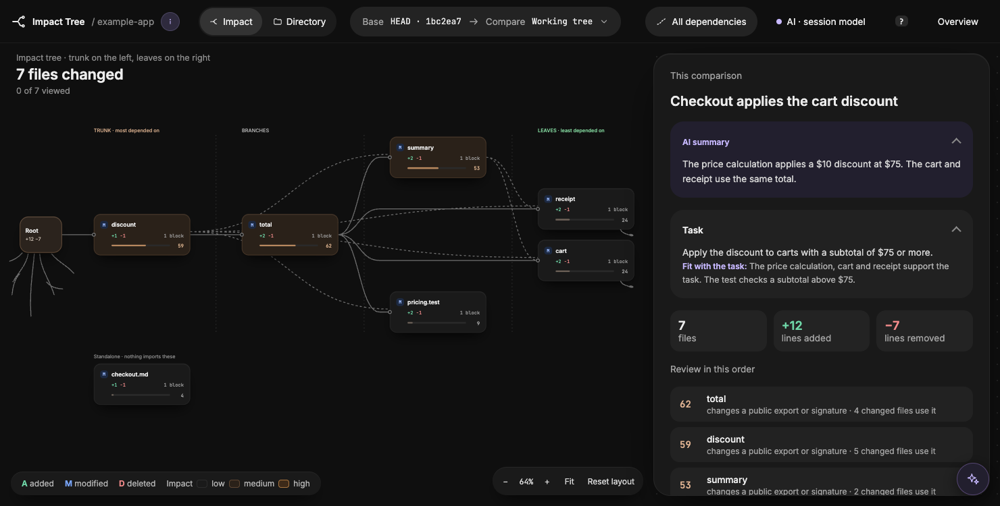

<p align="center">
  
</p>

<h1 align="center">Impact Tree</h1>

<p align="center"><strong>See which files a Git change can affect.</strong></p>

<p align="center">
  Impact Tree opens a Git comparison in your browser.
  The page shows dependencies, AI summaries, and diffs for changed files.
</p>

<p align="center">
  <a href="#install"></a>
  <a href="#install"></a>
  <a href="#requirements"></a>
</p>

<p align="center">
  <a href="#quick-start">Quick start</a> ·
  <a href="#install">Install</a> ·
  <a href="#review-changes">Review changes</a> ·
  <a href="#impact-score">Impact score</a> ·
  <a href="#settings">Settings</a> ·
  <a href="#troubleshooting">Troubleshooting</a>
</p>



## Quick start

1. [Install the skill](#install) for Claude Code or Codex.
2. Start the agent in the Git worktree you want to review.
3. Run `/impact-tree` in Claude Code or `$impact-tree` in Codex.
4. Open the local URL if the agent does not open it in your browser.

### Choose a comparison

With no arguments, Impact Tree compares `HEAD` with the current working tree. The diff includes untracked files that Git does not ignore.

| Claude Code example | Result |
| --- | --- |
| `/impact-tree main` | Compare `main` with the current working tree. |
| `/impact-tree main..topic` | Compare the merge base of `main` and `topic` with `topic`. |
| `/impact-tree main..topic --task "Apply the cart discount"` | Review the same diff with a task description for the AI summaries. |

Use the same arguments with `$impact-tree` in Codex. To change the comparison in the browser, press `/` to open the picker. The picker lists local branches, remote refs, recent commits, and worktrees. It also lists open GitHub pull requests when GitHub CLI can access the repository.

## Install

### Requirements

- Claude Code or Codex
- Python 3.9 or later
- Git and the `graphify` command on your `PATH`. [Install Graphify](https://github.com/Graphify-Labs/graphify#install).
- GitHub CLI (`gh`) with an active login, if you want the pull request picker

Clone the repository.

```sh
git clone https://github.com/utkarshk384/impact-tree.git
cd impact-tree
```

Run the installation command for your agent.

| Agent | Command |
| --- | --- |
| Claude Code | `./install.sh claude` |
| Codex | `./install.sh codex` |
| Both | `./install.sh both` |

The installer links the skill to this clone. It also adds a marked section to the agent's global instructions. Add `--no-instructions` to the installation command to skip that section.

## Review changes

1. Start in **Overview**. Read the comparison summary and review the suggested file order.
2. Select **Impact** to trace dependencies between changed files. Select **Directory** to browse changed files by folder.
3. Open a file to read its diff. Select **Unified** or **Side by side** to choose a diff view.
4. Read the file summary and the summary for each change block. Use **Used by** to find direct and indirect dependents.
5. Press `V` in the file view to mark the file as viewed.

Use the bars between change blocks to show unchanged lines. Press `C` to open **Change chat**. The chat can include the current file, the change block, or selected text as context.

### Edit a change

1. Choose **Working tree** as the comparison target.
2. Open the file you want to edit.
3. Select **Edit file** if the button appears.
4. Change the text in the diff blocks.
5. Select **Save to file**.

Impact Tree writes the edits to disk without staging them. It shows a read-only diff for comparisons with a commit or a different worktree.

### Keyboard shortcuts

| Action | Keys |
| --- | --- |
| Show all shortcuts | `?` |
| Open the command palette | `Ctrl+K` or `Cmd+K` |
| Open the comparison picker | `/` |
| Switch between Impact and Directory | `1` or `2` |
| Fit the tree to the canvas | `F` |
| Open or close Change chat | `Ctrl+J` or `Cmd+J` |

## Impact score

Impact Tree estimates the reach of each changed file on a scale from 0 to 100. Review higher scores first.

| Factor | Weight | What it measures |
| --- | --- | --- |
| Reach | 60% | The files that use the changed file. Direct use counts more than use through another file. |
| Change type | 25% | The kind of change, such as a change to an export or to a package dependency. |
| Size | 15% | The lines the change adds or removes, on a logarithmic scale. |

## Settings

Select the **AI** button in the header to choose the model and reasoning effort. The settings apply to new summary and chat jobs. Pass `--model` or `--effort` to the skill to change either setting for one run.

Impact Tree stores settings in `~/.config/change-tree/config.json`. If you set `XDG_CONFIG_HOME`, it uses that directory instead of `~/.config`. It stores comparison and summary data under `~/.cache/change-tree/`.

## Troubleshooting

| Problem | Action |
| --- | --- |
| The dependency graph is missing. | Run the Graphify skill in the worktree. Check that it creates `graphify-out/graph.json`. Start Impact Tree again. |
| The picker lists no pull requests. | Run `gh auth status` to check your GitHub login. Check that the repository has a GitHub remote with open pull requests. |
| Summaries or chat replies stay pending. | Check the agent session that started Impact Tree. Start the skill again if that session ended. |

To stop the local server, ask the agent that started it to stop Impact Tree. You can also run this command with the paths to your Impact Tree clone and the repository under review.

```sh
python3 /path/to/impact-tree/skill/impact-tree/scripts/ct.py stop \
  --repo /path/to/repository
```

